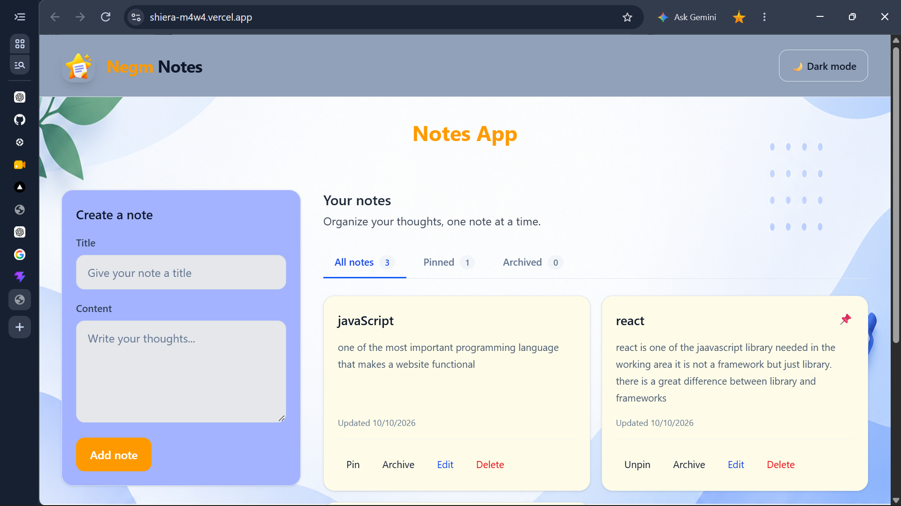
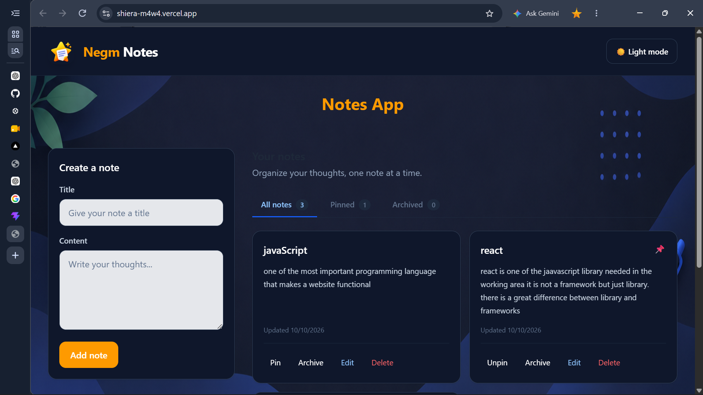

# Notes App

A responsive notes application built with React, TypeScript, Vite, and Tailwind CSS. Create, edit, pin, archive, and delete notes while keeping your data saved in your browser. Switch between light and dark themes to personalize your workspace.

## Screenshots

### Light Theme



### Dark Theme



> **Note:** Create a `screenshots` folder in the project root and add your actual application screenshots using the filenames above.

## Features

* **Create and edit notes:** Add notes with titles and content.
* **Pin notes:** Keep important notes easy to find.
* **Archive notes:** Move notes out of the main view without deleting them.
* **Delete notes:** Confirm before permanently removing a note.
* **Filter notes:** Switch between All Notes, Pinned, and Archived views.
* **Persistent storage:** Keep notes, theme preferences, and the selected view in browser `localStorage`.
* **Light and dark themes:** Toggle the appearance and remember the selected theme.
* **Responsive design:** Adapt the interface to different screen sizes.
* **Accessible interface:** Use form labels, keyboard navigation for view tabs, and clear button states.

## Technology Stack

* React
* TypeScript
* Vite
* Tailwind CSS v4
* React Context API
* `useReducer` for note state management
* Custom hooks
* Browser `localStorage`

## Project Structure

```text
notes-app/
├── public/
│   └── images/
│       └── notes-background.png
├── screenshots/
│   ├── light-mode.png
│   └── dark-mode.png
├── src/
│   ├── components/
│   │   ├── ThemeInitializer.tsx
│   │   ├── ThemeToggle.tsx
│   │   ├── NoteEditor.tsx
│   │   ├── NoteCard.tsx
│   │   ├── NoteList.tsx
│   │   └── ViewTabs.tsx
│   ├── contexts/
│   │   ├── ThemeContext.tsx
│   │   └── NotesContext.tsx
│   ├── hooks/
│   │   └── useLocalStorage.ts
│   ├── types/
│   │   └── note.ts
│   ├── App.tsx
│   ├── main.tsx
│   └── index.css
├── index.html
├── package.json
├── vite.config.ts
└── README.md
```

## State Management

The application separates local component state, shared React state, and persisted browser data. Each piece of state has a specific responsibility.

| State                 | Where it lives                                   | Why it lives there                                                                                |
| --------------------- | ------------------------------------------------ | ------------------------------------------------------------------------------------------------- |
| `notes`               | `NotesContext.tsx`, managed by `useReducer`      | Provides a central collection of notes and handles add, update, remove, pin, and archive actions. |
| Persisted notes       | `localStorage`, key `notes-data-v1`              | Preserves notes across page refreshes and browser sessions.                                       |
| `theme`               | `ThemeContext.tsx`, managed by `useLocalStorage` | Shares the selected light or dark theme across the application.                                   |
| Persisted theme       | `localStorage`, key `notes-theme-v1`             | Remembers the user's theme preference.                                                            |
| HTML dark-mode class  | `document.documentElement`                       | Controls Tailwind's manually selected `dark:` styles through the `.dark` class.                   |
| `activeView`          | `App.tsx`, managed by `useLocalStorage`          | Tracks which notes view is currently selected.                                                    |
| Persisted active view | `localStorage`, key `notes-active-view-v1`       | Remembers the selected view after a refresh.                                                      |
| `editingNote`         | `App.tsx`, managed by `useState`                 | Determines whether the editor creates a new note or edits an existing note.                       |
| `title`               | `NoteEditor.tsx`, managed by `useState`          | Tracks the title currently entered into the controlled form.                                      |
| `content`             | `NoteEditor.tsx`, managed by `useState`          | Tracks the content currently entered into the controlled form.                                    |
| `confirmDelete`       | `NoteCard.tsx`, managed by `useState`            | Controls the inline delete-confirmation interface for an individual card.                         |

### How Data Flows

1. The user enters a title and content in `NoteEditor`.
2. The editor calls the appropriate save handler in `App`.
3. `App` invokes an action exposed by the `useNotes` custom hook.
4. The action dispatches an action to the notes reducer.
5. The reducer returns the updated notes state.
6. React re-renders the components that use the updated state.
7. An effect persists the updated notes to `localStorage`.

The theme and selected view use the reusable `useLocalStorage` hook to synchronize their state with browser storage.

## Getting Started

### Prerequisites

* Node.js
* pnpm
* A modern web browser

### Installation

Clone your repository and enter the project directory:

```bash
git clone <your-repository-url>
cd notes-app
pnpm install
```

### Run the Development Server

```bash
pnpm dev
```

Open the local URL displayed in your terminal.

### Build for Production

```bash
pnpm build
```

### Check TypeScript

```bash
pnpm exec tsc -b
```

### Preview the Production Build

```bash
pnpm preview
```

## Browser Storage

The application uses browser `localStorage` to save preferences and notes.

| Key                    | Value                                         |
| ---------------------- | --------------------------------------------- |
| `notes-data-v1`        | Array of saved notes                          |
| `notes-theme-v1`       | Selected theme: `light` or `dark`             |
| `notes-active-view-v1` | Selected view: `all`, `pinned`, or `archived` |

Data is stored locally in the browser and is not automatically synchronized across devices. Clearing the site's browser storage can remove saved notes and preferences.

## Accessibility and User Experience

* Labels are associated with their corresponding form fields.
* View tabs support arrow-key navigation, Home, and End.
* Buttons expose relevant states where appropriate.
* Notes use responsive layouts and readable text spacing.
* Delete actions require confirmation.
* Both light and dark themes are supported.

## Future Improvements

* Search notes by title and content.
* Sort notes by creation or update date.
* Export and import notes.
* Add categories or tags.
* Add automated tests.
* Consider cloud synchronization and user authentication.

## Author

**Yesuf Esmael**

Software Engineering Student | Aspiring Frontend Developer

Built as a React and TypeScript learning project.

---

If you find this project useful, consider giving the repository a star.
